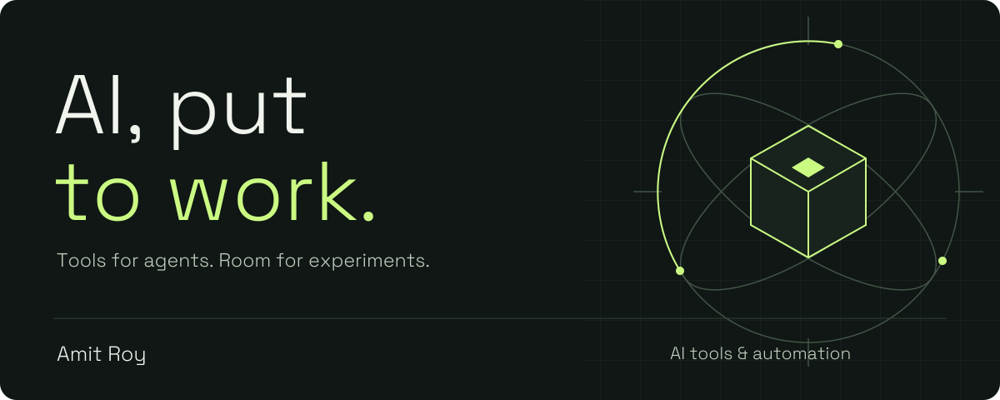

# Amit Roy

Independent developer building tools around AI agents, automation, and everyday development.

I like taking an idea far enough to use it, then improving the parts that get in the way.

## Things I'm building

### [Agent Console](https://github.com/Amit-Roy/agent-console)
A browser workspace for Claude Code, Codex, and Pi. Threads, files, and agent workflows, from a laptop or phone.

### [Claude Yoke](https://github.com/Amit-Roy/claude-yoke)
A terminal interface for Claude Code, with token usage, an agents panel, and a session browser.

### [Harden VPS](https://github.com/Amit-Roy/harden-vps)
Linux server setup and security automation: firewall rules, SSH hardening, and monitoring.

## How I approach the work

- Start with a concrete problem and build something usable.
- Keep people in control of the important decisions.
- Make the code available so others can inspect it, try it, and adapt it.

Have a specific problem or an idea to explore? Open an issue in the relevant project.

[Explore the repositories](https://github.com/Amit-Roy?tab=repositories) · [Agent Console tour](https://youtu.be/JNqju6qvxvc)
