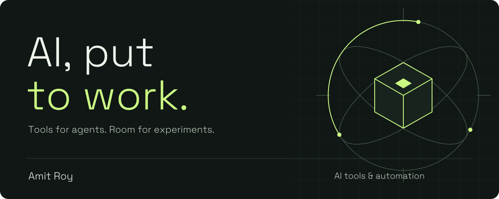

# Give the agents a workspace.

  

## About me

I'm Amit. I build tools around AI: places to run agents, see what they're doing, and connect them to everyday development.

- **AI workflows:** agent sessions, scheduled tasks, and work driven by GitHub issues.
- **Developer interfaces:** browser workspaces and terminal tools.
- **Infrastructure:** Linux server setup and security automation.

The interesting part for me is turning those pieces into something I can actually use, then improving the parts that get in the way.

## Project showcase

### [Agent Console](https://github.com/Amit-Roy/agent-console)

**Your agents. Your machine. Any screen.**

A browser workspace for **Claude Code, Codex, and Pi**. Pick up a thread on your laptop or phone, inspect files, and keep the work in view.

- **Work across agents.** Separate threads, resumable sessions, and cross-agent forks.
- **Stay close to the code.** File viewing, diffs, inline media, and session search.
- **Keep work moving.** Scheduled tasks and workflows driven by GitHub issues.

[Source code](https://github.com/Amit-Roy/agent-console) · [Watch the tour](https://youtu.be/JNqju6qvxvc) · [Issues](https://github.com/Amit-Roy/agent-console/issues)

### [Claude Yoke](https://github.com/Amit-Roy/claude-yoke)

**Keep Claude Code in view.** A terminal UI with live token usage, an agents panel, and a session browser.

[Source code](https://github.com/Amit-Roy/claude-yoke) · [Issues](https://github.com/Amit-Roy/claude-yoke/issues)

### [Harden VPS](https://github.com/Amit-Roy/harden-vps)

**Give the server a starting point.** Debian server hardening in one command: Docker-safe firewall rules, key-only SSH, and security monitoring.

[Source code](https://github.com/Amit-Roy/harden-vps) · [Issues](https://github.com/Amit-Roy/harden-vps/issues)

## Tools in these projects

    

## GitHub activity

Public GitHub data, refreshed daily. Language shares describe repository code, not proficiency.

## Have a workflow worth fixing?

Bring a concrete problem, a rough idea, or something you tried that didn't work.

[Start with a project issue](https://github.com/Amit-Roy/agent-console/issues) · [Explore all repositories](https://github.com/Amit-Roy?tab=repositories)
